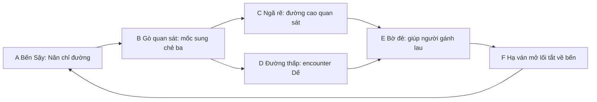

# P0 — Brief mẫu Unreal 15–20 phút

Ngày: 2026-11-10. Owner: `game-designer`. PM: phiên điều phối chính.
Trạng thái: **ĐÃ REVIEW TĨNH VÀ SỬA FINDING**, chưa có nghiệm thu UE hoặc playtest. Phạm vi file này là P0.2 và bản nháp ma trận phục vụ P0.3; đã có review độc lập theo góc QA/verifier cho brief, không thay ký duyệt văn hóa của người thật hoặc nghiệm thu gameplay. Không sửa dữ liệu/canon hiện hành.

Mọi địa điểm vi mô, hành động, lời thoại và nhiệm vụ mới dưới đây mang nhãn **[SÁNG TẠO]**. Các con số là giả thuyết thiết kế, không phải thời lượng hoặc hiệu năng đã đo. Nguồn làm việc: AI_CONTEXT; proposal 0.5; STORY_INTEGRATION_0_4 §4–6; roadmap P0–P5. GDD v0.1 chỉ tham khảo trụ cột, không phục hồi scope 9 chương/nhân vật Đồng đã cũ.

## 1. Câu hỏi mẫu phải trả lời

1. Người chưa biết dự án có hiểu Cói đang tìm Nghệ và tự tới mốc đầu không?
2. Một ngã rẽ, một encounter và việc giúp một người có khiến họ muốn khám phá tiếp không?
3. Cói, Dế Cõng Đá và một cảnh Bến Sậy đã đủ nhất quán về hình ảnh/chuyển động để nhân rộng chưa?

Mẫu chỉ kiểm **một vòng Bến Sậy → giúp người → mở lối tắt → về bến**. Đây không phải vùng Lợn Lòi 90–180 phút, không cả Long Biên/Hồ Tinh và không bản đầy đủ. Không gộp boss, bàn giao Bương hoặc toàn bộ cây kỹ năng vào mẫu.

## 2. Đầu ra cần bàn giao

- Một level nhỏ có sáu cụm A–F theo graph dưới; kích thước chỉ chốt sau blockout và đo nhịp đi.
- Cói cầm giáo; một Dế hoàn chỉnh; Năn và một người gánh lau chưa đặt tên (hai vai NPC, ưu tiên dùng chung nền rig). Năn ở bến vì đau chân; không đưa Năn ra nơi cần cứu.
- Một mục tiêu theo dõi, nhật ký tóm tắt, nút đọc lại chỉ dẫn; một encounter dạy đọc tín hiệu; một tương tác cứu giúp; lối tắt thay đổi thật trong cảnh.
- Ba checkpoint logic: `start`, `help_resolved`, `shortcut_open`. Lưu/load qua đóng game, không chỉ giữ biến trong phiên.
- Build Windows đóng gói, log, video một lượt không debug và bảng ghi playtest. Không lấy ảnh render đơn lẻ thay bằng chứng gameplay.

## 3. Graph và nhiệm vụ qua hành động

- Hai đường C/D nối lại trước E. C có chỗ quan sát rõ encounter và đường xuống; D có tiếp xúc gần hơn. Không cần đi cả hai để hoàn thành mẫu.
- Từ B nhìn được mốc tới E; từ E nhìn được bến. Mốc lớn nhất là cây sung chẻ ba, không dựa riêng vào marker UI.
- Người gánh lau bị kẹt cạnh bó hàng/ván đổ trên bờ cạn. Cói giúp tháo vật cản hoặc giữ ván để người đó bước ra; không cứu dưới nước sâu, không đánh người.
- Dế giữ ổ gần đường, không phải kẻ bắt cóc người. Người chơi có thể quan sát/né vòng hoặc đánh bật nó ra để tiếp cận; không cần giết. Không bắt nhặt nguyên liệu/đạt cấp mới được giúp người.
- Sau giúp người, Cói có thể hạ ván từ phía E tạo đường về bến. Ván/chỗ buộc là vật thể có công dụng, không tự mở cửa vì đủ bộ đếm.
- Mẫu kết thúc bằng phản ứng của Năn và một hướng mới về dấu Nghệ. End card nói rõ “hết mẫu”, không giả làm cổng khóa thế giới do thiếu 2/4 vật phẩm.

### Nhịp mục tiêu lần đầu

| Beat | Thời gian mục tiêu | Hành động | Câu hỏi/điều biết thêm |
|---|---:|---|---|
| A | 2–3 phút | Nhận chỉ dẫn, học di chuyển/đọc lại mục tiêu | Cói tìm ai? Vì sao Năn không tự đi? |
| B | 2–3 phút | Tự tìm mốc sung, nhìn ván/bó lau bị kéo | Người nào vừa đi qua đây, đường nào tới bờ đê? |
| C hoặc D | 4–5 phút | Chọn đường, quan sát Dế/đọc tín hiệu và tránh hoặc giao chiến | Con vật giữ chỗ nào, dấu hiệu trước khi nó tấn công là gì? |
| E | 3–4 phút | Giúp người, nghe lời kể ngắn trong hành động | Nghệ đã quay lại giúp người, không chỉ đi lạc |
| F → A | 4–5 phút | Mở/đi lối tắt, thấy NPC phản ứng và chỉ hướng kế | Việc của tôi thay đổi đường đi và thông tin như thế nào? |

Tổng ngân sách **15–20 phút**, gồm di chuyển/đọc/chơi trong từng beat. Không kéo dài bằng chờ tương tác, bắt chạy qua cả C lẫn D hoặc cày lại encounter. Người thành thạo đi nhanh hơn không phải lỗi tự động. Mốc E hé lộ việc Nghệ giúp người là nội dung đề xuất, phải qua verifier và không được tự ghi là canon đã duyệt.

## 4. State machine và chống kẹt

Các ID dưới là đề xuất implementation cho mẫu, chưa thêm vào JSON hiện hành:

| State | Điều kiện vào | Hành động khả dụng | Điều kiện ra |
|---|---|---|---|
| `sample_ready` | Bắt đầu hoặc load đầu mẫu | Nhận/đọc lại chỉ dẫn; đi tới B | Mục tiêu được nhận hoặc người chơi tới mốc B |
| `sample_route_known` | Đã tới B | Đi C hoặc D, quay bến; gọi trợ giúp định hướng theo yêu cầu | Tới E bằng bất kỳ tuyến hợp lệ |
| `sample_help_ready` | Tới E | Quan sát vật cản, xử lý Dế nếu cần, thao tác giúp người | Người đã ra khỏi vật cản an toàn |
| `sample_help_resolved` | Giúp xong | Nghe lại tóm tắt, mở ván; người được giúp chờ ở vị trí an toàn | Ván đã hạ thành lối đi |
| `sample_shortcut_open` | Ván đã hạ | Đi về bến hoặc quay lại vòng; checkpoint bền | Tới bến và nhận phản ứng kết mẫu |
| `sample_complete` | Hoàn thành vòng | Xem tóm tắt, chơi lại từ menu | Reset mẫu rõ ràng, không âm thầm giữ/cộng thưởng |

- Không vật phẩm chìa khóa tiêu hao. Bỏ qua câu thoại không làm mất mục tiêu; dữ kiện quan trọng đọc lại được.
- Tới E trước khi nói chuyện vẫn có thao tác giúp; journal bổ sung ngữ cảnh, không chặn người đi nhanh.
- Chết trước E hồi checkpoint phù hợp; chết sau giúp người không bắt cứu lại. Load sau mở ván giữ collision/path/quest thống nhất.
- Nếu ra xa trong lúc giúp, NPC trở về tư thế an toàn và thao tác có thể làm lại; không teleport vào vùng nguy hiểm.
- Thưởng/mốc quest chỉ ghi một lần. Không nhận thưởng vô hạn khi load, vào lại trigger hoặc nói chuyện lại.
- Kiểm đường C/D bằng navmesh và va chạm người chơi, không chỉ line nối trên sơ đồ. Lối tắt không thành đường vào vùng chưa có dữ liệu.

## 5. Must / Should / Cut cho mẫu

| Must — không được bỏ để cứu lịch | Should — thêm khi must đạt | Cut khỏi mẫu này |
|---|---|---|
| A–B–C/D–E–F có tuyến đọc được, một lối tắt thật | Một ngõ quan sát ngắn có payoff | Map 700×900 m/toàn vùng 90–180 phút |
| Cói, Dế, hai vai NPC đạt chuẩn mẫu ở camera gameplay | Thêm biến thể idle/sinh hoạt NPC | Boss Lợn Lòi/Hồ Tinh, đổi đời Bương |
| Move/camera/giáo/né/đỡ/Thế và hồi phục tối thiểu | Một phản ứng âm thanh khi mở lối tắt | Toàn bộ combat 0.4, build/loot/crafting rộng |
| Giúp người, hậu quả, một objective rõ và trợ giúp tùy chọn | Một lựa chọn lời đáp chỉ đổi sắc thái | Ba nhánh phụ đầy đủ, thu thập hàng loạt |
| Save/load checkpoint, retry, vi/en và remap cần thiết | Chỉnh nhịp tutorial theo setting | VO toàn bộ, cinematic dài, thế giới mở liên tục |
| License/source, log package và bằng chứng kiểm tra | Thêm điểm nhìn để art review | Tự mua asset, tự tuyên bố chuẩn AAA hoặc performance đạt |

Graybox được phép ở P1/P2 để debug. Gate hình ảnh P3/P4 không được đạt bằng việc giữ người/quái primitive rồi gọi đó là hoàn thiện. Giữ silhouette/layout rõ trước khi thêm foliage.

## 6. Chọn đúng ba nhánh phụ cho vùng 90–180 phút sau này

**Chưa triển khai trong mẫu**; chỉ sample hóa tình huống giúp người của nhánh thứ nhất để kiểm nghiệm. Khi ghép vào vùng lớn, không ép nhánh phụ thành khóa bắt buộc của main quest.

| Nhánh được chọn [SÁNG TẠO] | NPC/động cơ | Việc chơi và payoff | Điều không làm |
|---|---|---|---|
| Năn — chuyến đi dang dở | Năn đau chân ở bến, nhờ tìm người gánh lau chưa về | Giúp người theo hai đường; có người trở về bến, mở một lối an toàn | Không đưa Năn vừa ở bến vừa mắc kẹt; không biến thành đi tìm 12 đồ |
| Đót — bẫy đã bỏ | Đót muốn giải quyết hậu quả bẫy bỏ lại | Đọc vị trí và tháo một cụm bẫy có tình huống khác nhau; một đường trở nên an toàn | Không quy Đót thành nguồn ác toàn game; không phải nhổ mười bẫy giống nhau |
| Sung — vật dụng hỏng | Sung giúp hiểu dấu nghề, người làng cần dụng cụ dùng được | Quan sát/sửa một dụng cụ, thấy nó được dùng; mở hỗ trợ chuẩn bị cạy về sau | Không gọi khoen là bùa; không bán buff vô cớ để khóa tiến trình |

Các nhiệm vụ phụ 0.4 cũ là nội dung đã có, không tự xóa. Ba nhánh trên là lựa chọn thiết kế cho bản kế tiếp để PM/verifier đối chiếu và quyết định thay thế/tái dùng; chưa là thay đổi canon/dữ liệu được áp dụng.

## 7. Ma trận canon nhỏ: Cói và Bương

| Phần | Cói/mẫu mở đầu | Bương/đời Hùng 6 (ngoài mẫu) | Ràng buộc |
|---|---|---|---|
| Vai người chơi | Cói, dân thường nhà Vảy; tìm Nghệ | Bương, đời sau, kế thừa theo thiết kế đã chốt | Không phục hồi nhân vật Đồng/cốt truyện GDD cũ |
| Quan hệ | Nghệ là em trai; Năn bạn Nghệ, đau chân ở bến | Vầu/Kê thuộc đời Bương | Không kéo NPC đời sau về mẫu Cói |
| Boss/nguồn ác | Khoen không có phép, boss là nạn nhân; mẫu chỉ báo dấu, chưa đánh boss | Không cho người chơi đánh người/thần được thờ | Không tự thêm phản diện/vật thần/hệ phép |
| Từ ngữ | Chỉ dùng thông tin người chơi đã quan sát/được kể | Bộ từ cấm khoen/mảnh/chốt/lưỡi bẫy/đồng cũ/mắc ở cổ vẫn áp dụng | Localization và kiểm theo đời, không trộn hồi tưởng tự do |
| Nhãn nội dung | Tình huống cứu người/địa hình vi mô mới: [SÁNG TẠO] | Nội dung đời Bương giữ nguyên phạm vi cũ | AI chỉ xác minh mức B; không tự nhận phục dựng lịch sử/mức A |

## 8. Gate nghiệm thu có thể đo

### Gate kỹ thuật trước playtest người thật

UE package chạy từ thư mục giải nén trên máy PO, có build ID/commit/config và log. QA kiểm A→C→E và A→D→E, tới E trước thoại, chết trước/sau cứu, load ba checkpoint, mở lối tắt rồi load, nói lại/trigger lại không nhân thưởng. Không blocker, không phải bật debug để hoàn thành. Trình bày riêng lỗi còn lại và preset/máy đo; chưa có máy thật thì **BLOCKED**, không suy FPS từ SwiftShader.

### Nghiệm thu trải nghiệm với 5 người mới

- Cả năm chưa được tác giả chỉ đường trước phiên; ghi mức quen action RPG và trợ giúp họ tự bật. PM lưu build ID, thời gian từng beat, chỗ lạc/death/retry và nguyên lời nhận xét. Mẫu nhỏ không đại diện thị trường.
- Ít nhất **4/5** nói đúng Cói tìm Nghệ và tự tới B trong **5 phút** từ khi nhận quyền điều khiển (không tính setup máy).
- Ít nhất **4/5** hoàn thành vòng mà không được người điều hành chỉ vị trí; nếu dùng trợ giúp trong game thì ghi riêng, không giấu số lần dùng.
- Ít nhất **4/5** nêu được việc giúp người đã mở đường/thay đổi điều gì và đọc được một tín hiệu trước đòn Dế hoặc giải thích cách tránh ổ.
- Đoạn mất tiến triển liên tục **>3 phút** phải được ghi thành vấn đề layout/dạy, không tính là nội dung khám phá thành công. Không tự loại người bị lạc khỏi mẫu.
- Báo median/range thời lượng thực tế, tách AFK; mục tiêu 15–20 phút không phải quyền thêm filler nếu người chơi đi nhanh. Hỏi “có muốn đi tiếp, vì sao?” và ghi nguyên lời; ít hơn 4/5 muốn đi tiếp là tín hiệu bắt buộc xem lại trước nhân rộng.
- Gate hình ảnh: PO và reviewer xem video đi/chạy/đánh/đỡ/giúp người cùng camera; không lỗi gãy khớp/xuyên đất/camera che thao tác rõ. Dùng checklist riêng, không dùng 4/5 thích hình để thay QA kỹ thuật.

### Dừng/mở rộng

Hai vòng sửa vẫn không đạt mục tiêu định hướng hoặc mong muốn chơi tiếp: PM tổ chức review graph/phần chơi, không tăng map hoặc bật thêm agent để bù. Chỉ sau khi gate P4 đạt mới ghép vùng 90–180 phút; game cuối vẫn cần các gate khác. Đây là **brief nghiệm thu dự kiến**, chưa có người chơi hoặc reviewer nào được ghi PASS tại thời điểm viết.
