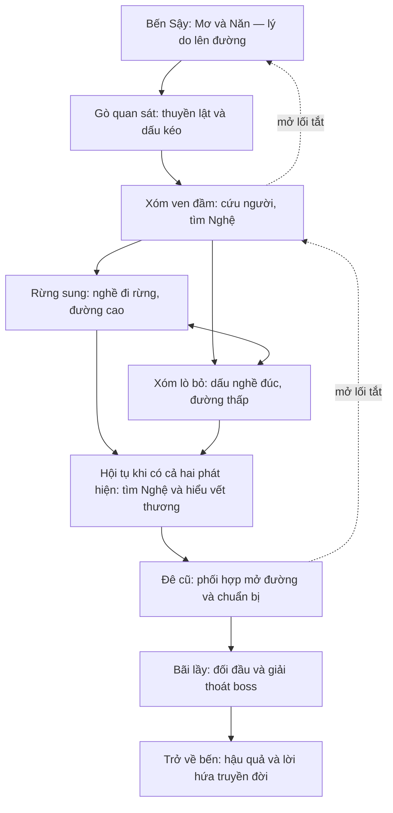

# Đề xuất 0.5 — một vùng phiêu lưu có cốt truyện, chuyển sang Unreal

Ngày: 2026-11-09. Trạng thái: **PHƯƠNG ÁN ĐỂ PO ĐỌC, chưa phê duyệt triển khai**.

Phạm vi: giải quyết phản hồi trải nghiệm Demo 0.4, không coi bản đã đạt smoke là bản đã đạt chất lượng chơi. Các con số dưới đây là mục tiêu thiết kế/giả thuyết cần playtest, không phải thời lượng hoặc hiệu năng đã đo. Địa điểm, sự kiện, nghề nghiệp và nội dung mới đều là [SÁNG TẠO], không phải khẳng định lịch sử.

## 1. Chọn hướng nào

Đề xuất: giữ nền tảng truyện Người Giữ Bến, thiết kế lại hành trình Cói ở vùng đầm thành **action RPG bán mở thiên về cốt truyện và khám phá**. Dùng Unreal cho bản hình ảnh tiếp theo. Web 0.4 giữ làm tài liệu kiểm tra luật chơi và dữ liệu, không tiếp tục đắp đồ họa để giả làm bản hoàn thiện.

Mục tiêu trải nghiệm lần đầu: **90–180 phút cho vùng mở đầu thử nghiệm**, không phải toàn chương Long Biên/Hồ Tinh hay thời lượng toàn game. Người chơi thành thạo có thể hoàn thành nhanh hơn; không ép đủ giờ bằng chờ đợi, chạy vòng, cày nguyên liệu hay tăng máu boss. Về dài hạn có thể nối nhiều vùng, nhưng chưa làm thế giới mở liên tục cả nước hoặc cả bốn chương cùng lúc.

Ba điều người chơi cần cảm thấy:
1. Tôi biết mình đang tìm ai, vì sao phải đi và nhìn đâu để định hướng.
2. Mỗi nhánh khám phá cho một phát hiện hoặc cách giải quyết có ý nghĩa.
3. Nơi này có người sống, có dấu vết sự việc đã xảy ra; boss là kết quả của câu chuyện tôi vừa khám phá.

Không dùng “rộng gấp X lần”, số NPC, số rương hoặc số cây làm tiêu chí thành công chính.

## 2. Chẩn đoán bản hiện tại

| Phản hồi | Quan sát từ repo/bản đã xem | Điều phải thay đổi |
|---|---|---|
| Không rõ đi đâu | Tuyến nhiệm vụ và vật nhặt có tồn tại nhưng landmark, lối đi và hậu quả nhiệm vụ chưa tạo chuỗi dẫn dắt đủ rõ | Thiết kế hành trình trước, tọa độ/địa hình theo hành trình |
| Map rộng mà vẫn chán | COMBAT_0_4 §6 và world_0_4 giữ nguyên điểm/tuyến cũ, thêm vùng bao quanh; diện tích đi được không đồng nghĩa nội dung có nghĩa | Bỏ yêu cầu giữ tọa độ cũ trong bản đồ kế tiếp, giữ ID dữ liệu khi cần tương thích |
| Nhiều hộp, người/quái thô | ART_DIRECTION và creatures_0_4 mới có brief; model nhân vật/quái hoàn thiện chưa được sản xuất | Pipeline concept → model → rig → animation → tích hợp, có nghiệm thu từng bước |
| Trống và thiếu chi tiết | PBR/foliage tạo bề mặt và mật độ, chưa đủ bố cục cảnh sinh hoạt và dấu vết kể chuyện | Dựng từng cụm cảnh có chức năng, không chỉ rải mesh |
| Tới boss quá nhanh | Nhiệm vụ 6 bước, nhiều bước hội tụ vào tuyến trung tâm; lối tới boss chưa cần một hành trình hiểu và chuẩn bị | Chuỗi phát hiện, cứu người, mở đường và chuẩn bị trước boss |
| Test đạt nhưng chơi chưa hay | Smoke chứng minh trạng thái/máy luật, không đo được hứng thú và khả năng tự tìm đường | Playtest người thật, hỏi lại hiểu biết và quan sát chỗ bị lạc |

## 3. Bố cục vùng mới: hai vòng khám phá và một đích nhìn thấy sớm

### 3.1 Sơ đồ quan hệ, chưa phải tọa độ thi công

- Nhìn thấy cây sung ba thân và ống khói lò từ sớm; boss để lại tác động trước khi được nhìn cận cảnh.
- Xóm ven đầm là nút trung tâm nhỏ. Rừng sung và xóm lò tạo một vòng, có thể đi hai thứ tự; tuyến chính cần thông tin từ cả hai, nhưng bằng chứng quan trọng có bản dự phòng nếu bỏ lỡ một NPC. Mỗi nhánh giải đáp một câu hỏi khác nhau, không chỉ chứa “vệt dấu số 1/2”.
- Phát hiện Nghệ không kết thúc chương: phải đưa em tới nơi an toàn, hiểu con thú đang đau vì thứ gì, chuẩn bị cách gỡ và mở đường tiếp cận.
- Lối tắt được mở từ phía bên kia và có thay đổi nhìn thấy được. Trở lại bến có NPC/phản ứng mới; tránh bắt quay nguyên con đường chỉ để nộp vật phẩm.
- Ngõ cụt ngắn phải có payoff: mẩu chuyện, góc nhìn, kỹ năng ứng dụng, cứu một người, hoặc vật phẩm có công dụng rõ. Không mặc định đặt rương ở mọi ngõ cụt.

### 3.2 Quy mô và nhịp di chuyển

Khung khảo sát ban đầu khoảng 700 × 900 m, chưa chốt diện tích đi được; nước sâu và vách là ranh giới tự nhiên. Không trải đều nội dung trên toàn hình chữ nhật. Chỉ mở rộng khi hành trình thử cho thấy thiếu không gian, không phóng map lên theo tỷ lệ để đạt thời lượng.

Mỗi tuyến có một mốc lớn, các mốc nhỏ và điểm khám phá nhìn thấy từ góc tiếp cận. Mục tiêu ban đầu: phần đi không tương tác giữa hai cụm chính khoảng 30–90 giây; đoạn dài hơn phải có quan sát, đổi địa hình hoặc sự kiện. Đây là nhịp đi giữa cụm, không phải luật đặt rương mỗi 30 giây. Đường cao cho quan sát/né phục kích; đường thấp cho tiếp cận gần, dấu bùn và tương tác môi trường.

Không cho chạy thẳng từ spawn vào boss. Rào cản phải có ý nghĩa: đê sạt, đường đi bị phá, cần hiểu cách giải thoát; khi đủ thông tin có hành động mở đường thực tế. Không dùng khóa vô hình “nhặt 2/4 dấu thì cửa tự mở”. Có đường hồi phục khi bỏ qua dấu, NPC vắng hoặc vật phẩm bị tiêu hao; vật phẩm nhiệm vụ không bán/mất vĩnh viễn.

## 4. Nhiệm vụ chính: mỗi chặng phải đổi điều người chơi hiểu

Ngân sách dưới đây là **95 phút nội dung tuyến chính lần đầu**, đã gồm di chuyển và hội thoại trong từng chặng, không cộng thêm một ngân sách đi bộ riêng.

| Chặng | Chơi gì | Điều biết thêm | Thay đổi thế giới | Mục tiêu thời lượng |
|---|---|---|---|---:|
| 1. Người chưa về | Mơ giao mục tiêu, Năn chỉ mốc; tự tìm thuyền lật từ bến | Nghệ đã quay lại giúp một người, không chỉ đi lạc | Làng chuẩn bị cứu người; mục tiêu có tên/người liên quan | 8 phút |
| 2. Những dấu không khớp | Theo dấu kéo, cứu người mắc ở đường đê; quan sát hai loại dấu thay vì nhặt tất cả | Con thú vừa càn phá vừa tránh nơi có người; có thứ làm nó đau | Người được cứu chỉ lối tắt về xóm | 18 phút |
| 3. Hai lời kể | Đi vòng rừng sung và xóm lò theo thứ tự tùy chọn; mỗi nhánh một tình huống ngắn; cần hai phát hiện khác loại, không thể bỏ cả một nhánh | Dấu ngoài rừng cho hướng đi; dấu nghề đúc giúp hiểu vật ở cổ. Không quy kết nhân vật lịch sử | Một NPC đổi thái độ; mở lối nối hai nhánh | 22 phút |
| 4. Gọi người về | Dùng thông tin vừa học tìm Nghệ; đi theo tiếng gọi/đồ vật quen; giữ khoảng an toàn giữa các đợt quái | Nghệ thấy con thú tìm cách tự gỡ vật ở cổ | Nghệ được đưa tới điểm trú, kể thêm chi tiết | 20 phút |
| 5. Đường qua đê cũ | Chọn đường cao hoặc hỗ trợ sửa lối thấp; thử thao tác ghì/gỡ ở vật vô tri, chuẩn bị hồi phục | Nhịp/đòn đánh là phương tiện tiếp cận để giúp con thú, không chỉ giết boss | Có đường cứu hộ/lối rút; checkpoint gần boss | 12 phút |
| 6. Chủ bãi lầy | Boss thể hiện hành vi đã báo trước; phá Thế, ghì và cạy; xem thay đổi sau giải thoát, trở về bến | Hiểu nguyên nhân trực tiếp và hậu quả với gia đình/làng | Đường bớt nguy hiểm, NPC phản ứng, lời hứa truyền đời có trọng lượng | 15 phút |

**95 + 35–60 phút nhánh phụ + 10–25 phút học/thử lại = khoảng 140–180 phút** cho người khám phá nhiều. Chơi chủ yếu tuyến chính nhắm 90–120 phút. Đây là dự toán phải thay bằng thời gian playtest. Nếu người chơi hiểu và chơi hay trong 75 phút thì không thêm filler để ép mốc 90.

Hội thoại chủ yếu ngắn, nói trong lúc đi/làm. Không biến phần mở rộng thành 60 phút đọc chữ hoặc chuỗi cinematic dài. Bỏ qua thoại không được làm mất mục tiêu cần thiết; nhật ký lưu tóm tắt bằng ngôn ngữ tự nhiên.

## 5. Nhánh phụ và NPC có vai trò, không “thêm cho đông”

Giữ Mơ, Nghệ, Năn, Đót và Sung làm tuyến nhân vật cốt lõi; tối đa 2 vai mới ở vòng đầu. Tên vai mới chỉ là tên chức năng, tên riêng xét sau. Vầu/Kê thuộc đời Bương, không đưa ngược sang thời Cói.

| Vai/nhánh [SÁNG TẠO] | Người chơi làm | Phát hiện hoặc lựa chọn | Kết quả thực tế |
|---|---|---|---|
| Năn — chuyến đi dang dở | Năn vẫn ở bến vì đau chân, nhờ tìm người gánh lau chưa về; chọn đường đưa người đó về an toàn hoặc đường ngắn | Vì sao Nghệ quay lại; người làng giúp nhau thế nào | Người được giúp xuất hiện ở bến; Năn có lời đáp và xác nhận một mốc; không khóa main nếu bỏ nhánh |
| Đót — bẫy đã bỏ | Đọc vị trí bẫy, tháo một cụm có tình huống khác nhau; không lặp nhổ 10 chiếc | Đót nhận trách nhiệm cho phần việc của mình, không bị biến thành phản diện đơn giản | Một lối đi an toàn hơn; quái đổi vị trí sinh hoạt |
| Người giữ đê — vai mới | Chuyển hướng dòng nước nông/sắp lại ván để mở lối | Dấu một trận phá đê cũ và cách làng thích nghi | Lối tắt phục vụ main; lời giải cơ bản luôn có nếu không làm nhánh |
| Sung — vật dụng hỏng | Đối chiếu dấu nghề, sửa một dụng cụ có sẵn | Hiểu vật liệu và cái giá của đúc vụng; khoen không có phép | Mở cách chuẩn bị hỗ trợ cạy, không bán chỉ số “+20%” vô cớ |
| Một gia đình ở rừng sung | Tìm nơi trú bằng âm thanh/dấu sinh hoạt; có thể chọn dẫn họ ra hoặc đánh dấu lối an toàn | Thấy ảnh hưởng của con thú lên đời sống ngoài gia đình Cói | Lửa/tiếng người trở lại một cụm cảnh, lời thoại sau boss đổi |

Chỉ chọn 3 nhánh phụ cho bản 90–180 phút, tổng 35–60 phút; các ví dụ còn lại là nguồn chọn, không mặc định cộng tất cả. Mỗi NPC có nhu cầu, thông tin riêng, hành động trong cảnh, phản ứng sau nhiệm vụ. Đám đông không cần ai cũng có cây hội thoại. Khoảng 5–8 người hoạt động trong hub, vài người ở cụm ngoài là giả thuyết đủ cho vùng nhỏ; không dựng hàng chục NPC rỗng.

Không nhiệm vụ “thu 12 cây/giết 20 con” để kéo dài. Vật nhặt có thể là lựa chọn tài nguyên ngắn; thông tin cốt truyện phải được hiểu qua hành động/quan sát, không bắt vét đồ.

## 6. Dẫn đường và khám phá: biết mục tiêu, tự chọn đường

- Khi nhận nhiệm vụ: một câu nói rõ việc/lý do, một mốc nhìn thấy và một tóm tắt có thể mở lại. Ví dụ: “Qua gốc sung chẻ ba, tìm vệt kéo xuống bờ đê” thay vì chỉ “tìm dấu vết”.
- HUD mặc định chỉ hiện một mục tiêu đang theo dõi, không đồng thời liệt kê 6 việc. Bản đồ có khu vực ước lượng và mốc đã biết; điểm chính xác là tùy chọn trợ giúp.
- Trước ngã rẽ cho nhìn mốc hoặc thấy hai tính chất đường. Ánh sáng, đường đất, bờ lau, hướng âm thanh và vệt sử dụng hỗ trợ nhau; không chỉ sơn vàng mọi vật.
- Mỗi phát hiện trả lời một câu hỏi và mở câu hỏi tiếp theo. Nhật ký ghi “biết gì/đi đâu/vì sao”, không chỉ đánh dấu 2/4.
- Khi quay lại, bớt phục kích cũ; một số cảnh thay đổi. Hồi sinh không xóa kiến thức/lối tắt. Checkpoint trước boss; retry nhắm dưới 30 giây từ điểm nghỉ tới vào trận, không xem lại cinematic bắt buộc.
- Có trợ giúp theo yêu cầu và trợ năng: đọc lại thoại, phụ đề, kích thước chữ, biểu tượng tương phản, bật chỉ đường rõ hơn, điều chỉnh nhịp cạy. Không tự coi người bị lạc là “khám phá thành công”.

## 7. Môi trường và hình ảnh: sản xuất một cảnh đạt trước khi phủ toàn map

### 7.1 Ba lớp cho mỗi cụm cảnh

1. **Không gian lớn:** bờ cao/thấp, hướng nước, đường chân trời, đường đi và điểm nhìn. Phải đọc được trước khi có cỏ.
2. **Sinh hoạt/chức năng:** chỗ cập thuyền, dây buộc, ván mòn, chỗ làm nghề, bếp, vật đang dùng. Mỗi thứ trả lời ai dùng/làm gì, tránh decor ngẫu nhiên.
3. **Câu chuyện gần:** dây bị kéo đứt, vết cọ cổ trên thân cây, một nơi làm việc bị bỏ dở. Có âm thanh, phản ứng NPC hoặc tương tác giúp hiểu.

Giữ khoảng trống có chủ đích cho chiến đấu và nhìn đường. Không lấy rải lau kín màn hình làm “chi tiết”; kiểm cả tầm nhìn vũ khí, đọc đòn, camera qua cành lá và đường boss.

### 7.2 Người và quái

**Nhân vật:** chọn một Cói làm chuẩn đầu tiên: model có cơ thể liền mạch, tỷ lệ và trang phục đúng art direction; mặt/tay đủ đọc ở camera chơi, tóc và vải nhất quán; skeleton chuẩn, skinning không gãy khớp; animation idle/đi/chạy/dừng/đổi hướng/cầm giáo/đánh/đỡ/né/tương tác/hit reaction. Retarget chỉ là bước đầu, cần chỉnh bàn tay bám sào, chân chạm đất, quán tính và tiếp xúc đòn. NPC tái dùng một số rig/animation, khác silhouette/mặt/trang phục theo vai; không làm một bộ hoàn toàn riêng cho từng người.

**Quái:** trước tiên làm Dế Cõng Đá và Lợn Lòi Đầm. Không chỉ đổi tên Cua rồi giữ hình cũ. Dế có lưng đá, chân xẻng và chuyển động đào/giữ ổ; boss có khối cơ thể, da/bờm, bùn theo nơi cọ, nanh và vật cứa cổ đọc được. Tạo hình quái phải có silhouette, vật liệu, chuyển động, âm thanh và hành vi riêng; “thêm gai/phóng to thú thường” chưa đủ. Không dùng thân người/giáp người cho Ụ Bùn. Boss phải thể hiện đau và tìm cách tự gỡ, để người chơi hiểu mục tiêu giải thoát trước lời giải thích cuối.

Pipeline mỗi asset: brief có nhãn/nguồn → 2–3 silhouette để chọn → concept màu/vật liệu → model high/low phù hợp → UV/PBR → rig/skin → animation → LOD/collision → tích hợp → nhìn và chơi thử ở camera thật. Chỉ làm một mẫu hoàn chỉnh rồi mới nhân rộng. Asset mua/tải phải kiểm license thương mại, quyền chỉnh sửa, phạm vi engine và nguồn gốc; ghi register. Theo luật repo, ảnh AI chỉ là placeholder có nhãn, không tự đưa vào bản phát hành.

**Mức cần đạt để PO xem:** 1 cảnh Bến Sậy, Cói và 1 quái phải vượt rõ chất lượng khối hộp; không duyệt từ một ảnh cận render đẹp. Cần video ngắn đi vòng, chạy, đánh và tương tác, kèm khung hình gameplay trước/sau cùng camera. Không hứa ngang AAA; đề xuất một phong cách hiện thực cách điệu nhất quán, có chi tiết ở nơi camera nhìn thấy.

## 8. Unreal: dùng thế nào và ai cần làm gì

- Cloud hiện không có Unreal/GPU Windows; module UE trong repo chưa từng build. **Bước bắt buộc đầu tiên là build và chạy project thật trên máy PO**, không tiếp tục báo hoàn thành bằng mã chưa chạy.
- Kiểm tra ma trận plugin và pin phiên bản sau build thử, giữ C++20 ArpgCore làm lõi luật; audit phần chỉ có ở web (story, inventory/map, boss 0.3/0.4) trước khi port. Không giả định copy prototype web là ra game UE.
- Landscape/mesh cho địa hình; bộ module nhà/bến/lò cùng tỷ lệ; foliage instancing; collision/navmesh/camera được kiểm từng cụm. Chọn tổ chức level đơn giản cho vùng thử; chỉ chọn World Partition/streaming khi đo có nhu cầu, không vì tên “open world”.
- Nanite chủ yếu xem xét cho cảnh tĩnh phù hợp. Lumen, bóng, cỏ và nước phải đo trên RTX 5050 8 GB; có cấu hình chất lượng và phương án giảm chi phí. Không mặc định bật mọi tính năng Epic, không khẳng định Nanite giải quyết rig/skinning/animation.
- Mục tiêu khảo sát ban đầu: 1080p, 60 fps ở cấu hình cân bằng, có chế độ thấp hơn; **chưa phải cam kết**. Đo frame time, VRAM, hitch và thời gian tải bằng build đóng gói. Nếu thất bại, tối ưu mật độ/LOD/material/lighting trước khi mở rộng map.
- Save/checkpoint lưu trạng thái nhiệm vụ, NPC, mở đường và boss. Có phục hồi nếu asset/level tải lỗi. Gói Windows chạy được từ giải nén, có log build và test; không dựa vào editor của người làm.

Cần PO/technical artist/modeler tham gia phần build trên Windows, duyệt thẩm mỹ và asset tùy biến. AI có thể viết brief, công cụ, dữ liệu và hỗ trợ code; không dùng điều đó thay cho model và animation đã kiểm bằng mắt/người chơi thật.

## 9. Làm theo thứ tự để tránh tốn credits

| Mốc | Sản phẩm để xem | Điều kiện đi tiếp |
|---|---|---|
| A — chốt hành trình | Sơ đồ vùng, nhiệm vụ, danh sách 3 nhánh phụ và câu hỏi cốt truyện mỗi chặng | PO duyệt hướng; thử kể lại hành trình không cần đọc lore dài |
| B — mở khóa Unreal | Project UE build/run được, đi lại/đánh một mục tiêu, đọc dữ liệu và save/checkpoint tối thiểu | Có log và video trên máy thật; audit port còn thiếu |
| C — mẫu 15–20 phút | Một vòng Bến Sậy → cứu người → mở lối tắt; Cói, 1 NPC và Dế có hình ảnh/animation mẫu | Người mới tự hiểu đường đi; hình ảnh đạt chuẩn mẫu; đo được hiệu năng |
| D — graybox toàn hành trình | Hai vòng khám phá, nhiệm vụ 6 chặng, boss; tận dụng asset mẫu, chưa phủ chi tiết toàn map | Playtest nhịp/hiểu truyện; sửa layout rẻ trước khi art hóa |
| E — art và nội dung có chọn lọc | Hoàn thiện cụm quan trọng, 3 nhánh phụ, quái/boss, âm thanh, camera | Không dùng quái/hình người hộp trong cảnh được nghiệm thu; asset/license đầy đủ |
| F — bản 90–180 phút | Build Windows đóng gói, save/load, trợ năng và báo cáo playtest | Chất lượng chơi + kỹ thuật + nội dung đều qua, không chỉ smoke |

Không hứa số ngày hoàn thành trước khi đo thời gian làm một mẫu ở mốc C. Chi phí phụ thuộc asset có sẵn hay đặt riêng; lập bảng “tái dùng/mua/chỉnh sửa/tạo mới” và trần ngân sách trước khi mua. Không tự mua asset.

Quy tắc tiết kiệm: một việc chính tại một thời điểm; chỉ gọi reviewer ngắn ở điểm quyết định; dùng dữ liệu/logic đã có; không lặp lại smoke dài khi chỉ sửa tài liệu; test luật bằng unit test, test tuyến bằng phiên chơi ngắn, test toàn vùng ở mốc tích hợp. Không dựng cả map rồi mới hỏi người chơi có muốn chơi tiếp hay không.

## 10. Nghiệm thu bằng người chơi, không chỉ bot

Thăm dò với 3 người chưa biết dự án để tìm vấn đề định tính. Đợt nghiệm thu kế tiếp dùng 5 người độc lập, áp dụng ngưỡng 4/5 dưới đây; cả hai đều không đủ để suy rộng thị trường.

| Câu hỏi | Cách kiểm | Ngưỡng thử ban đầu |
|---|---|---|
| Người chơi có biết đi đâu? | Sau mở đầu hỏi mục tiêu/người cần tìm; quan sát không gợi ý | Ít nhất 4/5 người nêu được mục tiêu và tự tới mốc đầu trong 5 phút |
| Khám phá có ý nghĩa? | Hỏi điều mới học/đường mới mở sau mỗi nhánh | Không có nhánh bắt buộc chỉ trả lời “nhặt xong đồ” |
| Bị lạc hay đang tự khám phá? | Ghi nơi quay vòng, mở map liên tục, xin trợ giúp | Đoạn không tiến triển >3 phút được xem lại layout; không tự coi đó là thời lượng hay |
| Nhịp chơi có đúng? | Ghi thời gian từng chặng, thời gian đọc/chạy/chơi và số lần chết | Báo median và khoảng; không tính đứng AFK, không tăng filler để khớp target |
| Có hiểu boss? | Trước boss hỏi nó nguy hiểm thế nào và mục tiêu kết trận | Đa số mô tả được một dấu hiệu đã học và mục tiêu giải thoát |
| Có muốn chơi tiếp? | Hỏi ở phút 20–30 và sau boss; ghi nguyên lời | Nếu từ chối vì chán/lạc, sửa nguyên nhân trước khi thêm diện tích |
| Hình ảnh đạt chưa? | Gameplay camera thật, chuyển động, mặt/tay/cận quái và góc môi trường | Không gãy rig/xuyên đất rõ; người/quái đọc được silhouette và vật liệu |

Kiểm tự động vẫn cần cho quest/save/softlock, cổng, hitbox, collision, localization và các từ cấm theo đời. Đo hiệu năng thật riêng; không dùng FPS SwiftShader làm bằng chứng. Nhánh lựa chọn phải kiểm cả bỏ qua NPC, làm đảo thứ tự, chết giữa nhiệm vụ và load lại save.

## 11. Tính liên tục và giới hạn văn hóa

Giữ cấu trúc truyện H và dòng họ Vảy; Cói vẫn là dân thường chèo đò. Khoen không có phép; boss là nạn nhân, kết bằng giải thoát; không thêm trận đánh người hay tự biến thần được thờ thành đối thủ. Không thêm loài nước/rắn/cáo ở phần mở Long Biên đang bị ràng buộc. Trước khi viết nội dung đời Bương, vẫn áp dụng bộ từ cấm khoen/mảnh/chốt/lưỡi bẫy/đồng cũ/mắc ở cổ.

Trong bản 90–180 phút đề xuất, hành trình Cói chiếm phần chơi chính. Bàn giao cho Bương là epilogue có tương tác ngắn, không ép người chơi bước ngay vào một tutorial dài khác. Không tự thay các quyết định lore đã chốt; nội dung mới cần historian-verifier phản biện, tối đa mức B của AI, không tuyên bố mức A/historical authenticity.

## 12. Nguồn, điều đã biết và phần nghiên cứu cần làm tiếp

### Đã đọc trong repo

- `AI_CONTEXT.md`, `CLAUDE.md`, `reports/HANDOFF_0_4.md` và `reports/DEMO_0_4_REPORT.md`: trạng thái thực tế và giới hạn build.
- `research/narrative/STORY_INTEGRATION_0_4.md` §4–6; `design/data/quests.json`: nhân vật, tuyến nhiệm vụ, lý do và giới hạn truyện.
- `design/COMBAT_0_4.md` §6; `design/data/world_0_4.json`: giữ tọa độ cũ, tuyến/vùng mở rộng và gate vệt dấu.
- `docs/ART_DIRECTION.md`, `docs/TECH_SPEC.md`, `docs/DEMO_PLAN.md`; `design/data/creatures_0_4.json`: chuẩn hình ảnh đề xuất và các hạng mục chưa được sản xuất.

### Tài liệu chính thức cần đối chiếu khi pin UE

- Epic: World Partition — https://dev.epicgames.com/documentation/en-us/unreal-engine/world-partition-in-unreal-engine
- Epic: Animation Retargeting — https://dev.epicgames.com/documentation/en-us/unreal-engine/animation-retargeting-in-unreal-engine
- Epic: Lumen Performance Guide — https://dev.epicgames.com/documentation/en-us/unreal-engine/lumen-performance-guide-for-unreal-engine

Đã thử truy cập cả ba trong phiên lập phương án nhưng proxy trả 403 Forbidden. Các link là danh mục đối chiếu tiếp, **không được coi là tài liệu đã truy cập/xác minh phiên bản hiện hành**. Không có nghiên cứu thực nghiệm mới về Elden Ring/Black Myth hoặc playtest trong phiên này. Nguyên lý trong phương án là đề xuất thiết kế, không gán thành số liệu của các game tham chiếu.

### Nghiên cứu trước khi xây rộng

1. Review 3 tuyến mẫu do người thật chơi ở mốc C: một tuyến định hướng bằng landmark, một nhánh kể chuyện qua môi trường, một encounter giới thiệu điểm yếu quái. Ghi thời gian và nơi cần gợi ý.
2. So sánh 2 phương án hub/tuyến trên graybox cùng nội dung; chọn bằng khả năng hiểu đường và mong muốn khám phá, không chọn bằng diện tích.
3. Thử một bộ người + một bộ quái trong UE: chất lượng chuyển động/retarget, công làm chỉnh sửa, quyền thương mại, kích thước và hiệu năng.
4. Đối chiếu nguồn văn hóa cho trang phục/đời sống/nghề đúc; nếu chưa đủ nguồn thì dùng nhãn [SÁNG TẠO], không viết thành phục dựng lịch sử.

## 13. Các quyết định PO cần đọc và duyệt

Đề xuất mặc định để duyệt cả gói: (1) vùng **bán mở** thay cho thế giới mở liên tục; (2) 90–180 phút cho vùng mở đầu (lát cắt Lợn Lòi Đầm), không hứa toàn game; (3) chuyển bản hình ảnh kế tiếp sang **Unreal**, chỉ xây rộng sau mẫu 15–20 phút đạt; (4) đồng ý thiết kế lại tọa độ/layout thay vì bảo toàn map cũ; (5) chọn chuẩn hiện thực cách điệu nhất quán và làm Cói + một quái hoàn chỉnh trước khi nhân rộng.

Sau khi duyệt, việc đầu tiên là mốc A/B, không tự xây ngay bản đồ khổng lồ hoặc mua hàng loạt asset. Bản này chưa thay PLAN/GDD/data chính thức, chưa phê duyệt gate 2/4, chưa xác nhận engine build, ngân sách asset hoặc lịch sản xuất.
